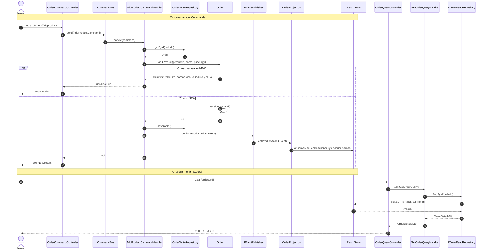
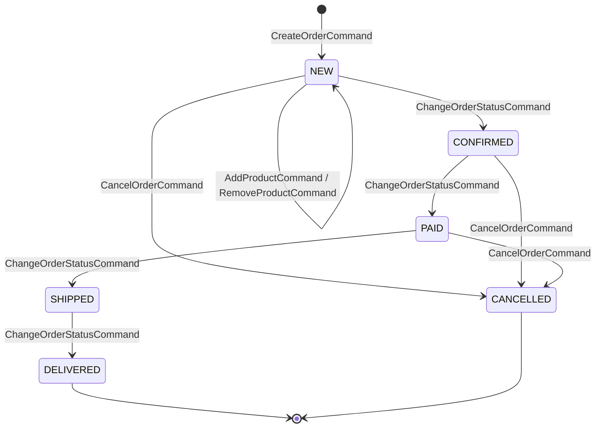
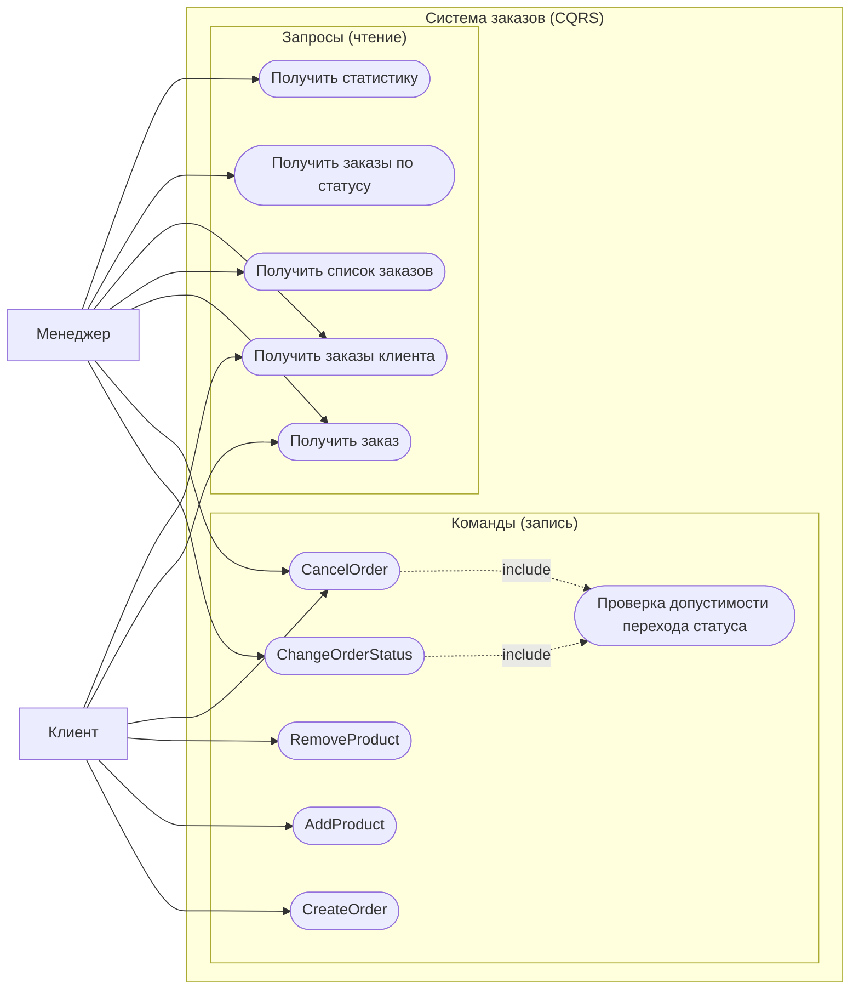

**Работа: Султанов Самир, группа ИСП-31, вариант 19**

# Проектирование системы заказов «Order Management» на основе CQRS (Вариант 19)

Архитектурное проектирование системы управления заказами, в которой операции изменения данных (**Commands**) отделены от операций чтения (**Queries**), в соответствии с паттерном **CQRS**, принципами **SOLID** и стандартом моделирования **UML 2.5**.

---

## Оглавление
1. [Описание предметной области и задачи](#1-описание-предметной-области-и-задачи)
2. [Архитектура приложения (CQRS)](#2-архитектура-приложения-cqrs)
3. [UML-диаграммы и их объяснение](#3-uml-диаграммы-и-их-объяснение)
4. [Описание алгоритмов](#4-описание-алгоритмов)
5. [Спецификация интерфейсов и DTO](#5-спецификация-интерфейсов-и-структуры-данных-dto)
6. [Бизнес-правила системы](#6-бизнес-правила-системы)

---

## 1. Описание предметной области и задачи

Цель работы — спроектировать систему заказов, где изменение состояния выполняется **только командами**, а получение информации — **только запросами**.

Заказ содержит: **клиента**, **позиции**, **стоимость**, **дату создания**, **статус**.

### Основные возможности системы:
* **Создание заказа** — клиент создаёт заказ с начальным набором позиций.
* **Редактирование состава** — добавление и удаление товаров, пока заказ в статусе `NEW`.
* **Смена статуса** — перевод заказа по жизненному циклу `NEW → CONFIRMED → PAID → SHIPPED → DELIVERED`.
* **Отмена заказа** — из статусов `NEW`, `CONFIRMED`, `PAID`.
* **Чтение данных** — получение заказа, списка, заказов клиента, заказов по статусу и общей статистики.

### Требования задания
| Требование | Как выполнено |
|---|---|
| Команды не читают данные | Команды возвращают `void`; обработчики используют только `IOrderWriteRepository` |
| Query не меняют состояние | Обработчики запросов используют только `IOrderReadRepository` (методы только `find*`/`get*`) |
| Handler для каждой команды | 5 классов `*CommandHandler` |
| Handler для каждого запроса | 5 классов `*QueryHandler` |
| Отдельные модели чтения и записи | Запись: `Order`, `OrderItem`. Чтение: `OrderDetailsDto`, `OrderSummaryDto`, `OrderStatisticsDto` |

---

## 2. Архитектура приложения (CQRS)

Система разделена на две независимые стороны. Единственная связь между ними — **доменные события**, по которым проекция обновляет хранилище чтения.

### Схема распределения

```
                        ┌──────────────────────────┐
                        │   PRESENTATION (API)     │
                        │ OrderCommandController   │
                        │ OrderQueryController     │
                        └─────┬──────────────┬─────┘
                  Command     │              │    Query
        ┌─────────────────────▼───┐      ┌───▼─────────────────────┐
        │      COMMAND SIDE       │      │       QUERY SIDE        │
        │  ICommandBus            │      │  IQueryBus              │
        │  *CommandHandler (x5)   │      │  *QueryHandler (x5)     │
        │  Order, OrderItem       │      │  OrderDetailsDto        │
        │  IOrderWriteRepository  │      │  OrderSummaryDto        │
        │                         │      │  OrderStatisticsDto     │
        │                         │      │  IOrderReadRepository   │
        └───────────┬─────────────┘      └───────────▲─────────────┘
                    │ DomainEvent                    │ читает
                    ▼                                │
              IEventPublisher ──► OrderProjection ──►  Read Store
        ┌───────────────────────────────────────────────────────┐
        │  INFRASTRUCTURE: SqlOrderWriteRepository,             │
        │  SqlOrderReadRepository, InMemory*Bus                 │
        └───────────────────────────────────────────────────────┘
```

### Command side (запись)
* **Команды** — неизменяемые объекты с данными намерения:
  `CreateOrderCommand`, `AddProductCommand`, `RemoveProductCommand`, `ChangeOrderStatusCommand`, `CancelOrderCommand`.
* **Command Handler** — по одному на команду: загружает агрегат `Order`, вызывает его метод, сохраняет, публикует событие.
* **Модель записи** — агрегат `Order` с вложенными `OrderItem`; хранит инварианты и правила переходов статуса.
* **`ICommandBus`** — маршрутизирует команду к её единственному обработчику.

### Query side (чтение)
* **Запросы** — `GetOrderQuery`, `GetOrdersListQuery`, `GetCustomerOrdersQuery`, `GetOrdersByStatusQuery`, `GetOrderStatisticsQuery`.
* **Query Handler** — по одному на запрос: обращается к `IOrderReadRepository`, возвращает DTO.
* **Модель чтения** — плоские денормализованные DTO, оптимизированные под выборки; не содержат логики.
* **`IQueryBus`** — маршрутизирует запрос к обработчику и возвращает результат.

### Синхронизация сторон
После сохранения агрегата обработчик команды публикует `DomainEvent`. `OrderProjection` подписан на события и обновляет денормализованную таблицу чтения (включая агрегаты для статистики).

### Таблица распределения компонентов

| Сторона | Компонент | Роль |
|---|---|---|
| Presentation | `OrderCommandController` | Принимает HTTP-запросы на изменение, создаёт команды, отправляет в `ICommandBus` |
| Presentation | `OrderQueryController` | Принимает HTTP-запросы на чтение, отправляет запросы в `IQueryBus` |
| Command | `CreateOrderCommandHandler` | Создаёт заказ с позициями, публикует `OrderCreatedEvent` |
| Command | `AddProductCommandHandler` | Добавляет позицию, пересчитывает стоимость, `ProductAddedEvent` |
| Command | `RemoveProductCommandHandler` | Удаляет позицию, пересчитывает стоимость, `ProductRemovedEvent` |
| Command | `ChangeOrderStatusCommandHandler` | Проверяет допустимость перехода, `OrderStatusChangedEvent` |
| Command | `CancelOrderCommandHandler` | Отменяет заказ, `OrderCancelledEvent` |
| Command | `Order`, `OrderItem` | Агрегат записи, инварианты |
| Command | `IOrderWriteRepository` | `getById`, `save` |
| Query | `GetOrderQueryHandler` | Возвращает `OrderDetailsDto` |
| Query | `GetOrdersListQueryHandler` | Возвращает страницу `OrderSummaryDto` |
| Query | `GetCustomerOrdersQueryHandler` | Заказы клиента |
| Query | `GetOrdersByStatusQueryHandler` | Заказы по статусу |
| Query | `GetOrderStatisticsQueryHandler` | Возвращает `OrderStatisticsDto` |
| Query | `IOrderReadRepository` | Только методы чтения |
| Sync | `OrderProjection` | Применяет события к хранилищу чтения |

---

## 3. UML-диаграммы и их объяснение

Исходные файлы диаграмм также лежат в папке [`diagrams/`](diagrams).

### 3.1. Диаграмма классов (Class Diagram)

```mermaid
classDiagram
    direction TB

    class OrderStatus {
        <<enumeration>>
        NEW
        CONFIRMED
        PAID
        SHIPPED
        DELIVERED
        CANCELLED
    }

    %% ---------- Presentation ----------
    class OrderCommandController {
        -ICommandBus commandBus
        +createOrder(request)
        +addProduct(orderId, request)
        +removeProduct(orderId, productId)
        +changeStatus(orderId, request)
        +cancelOrder(orderId)
    }

    class OrderQueryController {
        -IQueryBus queryBus
        +getOrder(orderId)
        +getOrders(page, size)
        +getCustomerOrders(customerId)
        +getOrdersByStatus(status)
        +getStatistics()
    }

    %% ---------- Command side ----------
    class ICommandBus {
        <<interface>>
        +send(command) void
    }

    class ICommandHandler~TCommand~ {
        <<interface>>
        +handle(TCommand command) void
    }

    class CreateOrderCommand {
        +string customerId
        +List~OrderItemDto~ items
    }
    class AddProductCommand {
        +int orderId
        +string productId
        +string productName
        +decimal unitPrice
        +int quantity
    }
    class RemoveProductCommand {
        +int orderId
        +string productId
    }
    class ChangeOrderStatusCommand {
        +int orderId
        +OrderStatus newStatus
    }
    class CancelOrderCommand {
        +int orderId
        +string reason
    }

    class CreateOrderCommandHandler {
        -IOrderWriteRepository repo
        -IEventPublisher events
        +handle(CreateOrderCommand) void
    }
    class AddProductCommandHandler {
        -IOrderWriteRepository repo
        -IEventPublisher events
        +handle(AddProductCommand) void
    }
    class RemoveProductCommandHandler {
        -IOrderWriteRepository repo
        -IEventPublisher events
        +handle(RemoveProductCommand) void
    }
    class ChangeOrderStatusCommandHandler {
        -IOrderWriteRepository repo
        -IEventPublisher events
        +handle(ChangeOrderStatusCommand) void
    }
    class CancelOrderCommandHandler {
        -IOrderWriteRepository repo
        -IEventPublisher events
        +handle(CancelOrderCommand) void
    }

    %% ---------- Write model (domain) ----------
    class Order {
        +int id
        +string customerId
        +List~OrderItem~ items
        +decimal totalPrice
        +datetime createdAt
        +OrderStatus status
        +addProduct(productId, name, price, qty) void
        +removeProduct(productId) void
        +changeStatus(OrderStatus newStatus) void
        +cancel(reason) void
        -recalculateTotal() void
    }
    class OrderItem {
        +string productId
        +string productName
        +decimal unitPrice
        +int quantity
        +lineTotal() decimal
    }
    class IOrderWriteRepository {
        <<interface>>
        +getById(int id) Order
        +save(Order order) void
    }
    class IEventPublisher {
        <<interface>>
        +publish(DomainEvent event) void
    }
    class DomainEvent {
        <<abstract>>
        +int orderId
        +datetime occurredAt
    }
    class OrderCreatedEvent
    class ProductAddedEvent
    class ProductRemovedEvent
    class OrderStatusChangedEvent
    class OrderCancelledEvent

    %% ---------- Query side ----------
    class IQueryBus {
        <<interface>>
        +ask(query) TResult
    }
    class IQueryHandler~TQuery~ {
        <<interface>>
        +handle(TQuery query) TResult
    }
    class GetOrderQuery {
        +int orderId
    }
    class GetOrdersListQuery {
        +int page
        +int size
    }
    class GetCustomerOrdersQuery {
        +string customerId
    }
    class GetOrdersByStatusQuery {
        +OrderStatus status
    }
    class GetOrderStatisticsQuery

    class GetOrderQueryHandler {
        -IOrderReadRepository readRepo
        +handle(GetOrderQuery) OrderDetailsDto
    }
    class GetOrdersListQueryHandler {
        -IOrderReadRepository readRepo
        +handle(GetOrdersListQuery) List~OrderSummaryDto~
    }
    class GetCustomerOrdersQueryHandler {
        -IOrderReadRepository readRepo
        +handle(GetCustomerOrdersQuery) List~OrderSummaryDto~
    }
    class GetOrdersByStatusQueryHandler {
        -IOrderReadRepository readRepo
        +handle(GetOrdersByStatusQuery) List~OrderSummaryDto~
    }
    class GetOrderStatisticsQueryHandler {
        -IOrderReadRepository readRepo
        +handle(GetOrderStatisticsQuery) OrderStatisticsDto
    }

    %% ---------- Read model ----------
    class OrderDetailsDto {
        +int id
        +string customerId
        +List~OrderItemDto~ items
        +decimal totalPrice
        +datetime createdAt
        +string status
    }
    class OrderSummaryDto {
        +int id
        +string customerId
        +int itemsCount
        +decimal totalPrice
        +datetime createdAt
        +string status
    }
    class OrderStatisticsDto {
        +int totalOrders
        +decimal totalRevenue
        +decimal averageOrderValue
        +Map~string,int~ countByStatus
    }
    class IOrderReadRepository {
        <<interface>>
        +findById(int id) OrderDetailsDto
        +findAll(page, size) List~OrderSummaryDto~
        +findByCustomer(string customerId) List~OrderSummaryDto~
        +findByStatus(OrderStatus status) List~OrderSummaryDto~
        +getStatistics() OrderStatisticsDto
    }
    class OrderProjection {
        -IOrderReadStore store
        +on(DomainEvent event) void
    }

    %% ---------- Infrastructure ----------
    class SqlOrderWriteRepository
    class SqlOrderReadRepository
    class InMemoryCommandBus
    class InMemoryQueryBus
    class InMemoryEventPublisher

    %% ---------- Relations ----------
    OrderCommandController --> ICommandBus
    OrderQueryController --> IQueryBus
    InMemoryCommandBus ..|> ICommandBus
    InMemoryQueryBus ..|> IQueryBus
    InMemoryEventPublisher ..|> IEventPublisher

    CreateOrderCommandHandler ..|> ICommandHandler
    AddProductCommandHandler ..|> ICommandHandler
    RemoveProductCommandHandler ..|> ICommandHandler
    ChangeOrderStatusCommandHandler ..|> ICommandHandler
    CancelOrderCommandHandler ..|> ICommandHandler

    CreateOrderCommandHandler ..> CreateOrderCommand
    AddProductCommandHandler ..> AddProductCommand
    RemoveProductCommandHandler ..> RemoveProductCommand
    ChangeOrderStatusCommandHandler ..> ChangeOrderStatusCommand
    CancelOrderCommandHandler ..> CancelOrderCommand

    CreateOrderCommandHandler ..> IOrderWriteRepository
    AddProductCommandHandler ..> IOrderWriteRepository
    RemoveProductCommandHandler ..> IOrderWriteRepository
    ChangeOrderStatusCommandHandler ..> IOrderWriteRepository
    CancelOrderCommandHandler ..> IOrderWriteRepository
    CreateOrderCommandHandler ..> IEventPublisher

    Order "1" *-- "1..*" OrderItem
    Order --> OrderStatus
    SqlOrderWriteRepository ..|> IOrderWriteRepository

    OrderCreatedEvent --|> DomainEvent
    ProductAddedEvent --|> DomainEvent
    ProductRemovedEvent --|> DomainEvent
    OrderStatusChangedEvent --|> DomainEvent
    OrderCancelledEvent --|> DomainEvent
    OrderProjection ..> DomainEvent

    GetOrderQueryHandler ..|> IQueryHandler
    GetOrdersListQueryHandler ..|> IQueryHandler
    GetCustomerOrdersQueryHandler ..|> IQueryHandler
    GetOrdersByStatusQueryHandler ..|> IQueryHandler
    GetOrderStatisticsQueryHandler ..|> IQueryHandler

    GetOrderQueryHandler ..> IOrderReadRepository
    GetOrdersListQueryHandler ..> IOrderReadRepository
    GetCustomerOrdersQueryHandler ..> IOrderReadRepository
    GetOrdersByStatusQueryHandler ..> IOrderReadRepository
    GetOrderStatisticsQueryHandler ..> IOrderReadRepository

    SqlOrderReadRepository ..|> IOrderReadRepository
    IOrderReadRepository ..> OrderDetailsDto
    IOrderReadRepository ..> OrderSummaryDto
    IOrderReadRepository ..> OrderStatisticsDto
```



#### Объяснение диаграммы классов
1. **Разделение сторон.** Контроллеры зависят только от шин (`ICommandBus`, `IQueryBus`) и ничего не знают об обработчиках.
2. **Команды и обработчики.** Каждый `*CommandHandler` реализует `ICommandHandler<TCommand>` и зависит от `IOrderWriteRepository` и `IEventPublisher`. Модели чтения ему недоступны.
3. **Запросы и обработчики.** Каждый `*QueryHandler` реализует `IQueryHandler<TQuery, TResult>` и зависит только от `IOrderReadRepository`. Доменная модель `Order` ему недоступна.
4. **Rich Domain Model.** `Order` сам проверяет инварианты (`addProduct`, `removeProduct`, `changeStatus`, `cancel`) и пересчитывает `totalPrice`.
5. **Агрегация состава.** `Order "1" *-- "1..*" OrderItem` — позиции не существуют вне заказа (композиция).
6. **События.** Все события наследуют `DomainEvent`; их обрабатывает `OrderProjection`.
7. **DIP.** Инфраструктурные классы (`Sql*Repository`, `InMemory*Bus`) реализуют интерфейсы, определённые на уровне приложения.

---

### 3.2. Диаграмма последовательности (Sequence Diagram)

Сценарий: **«Добавление товара в заказ»** (команда) и **«Получение заказа»** (запрос).



#### Пошаговое объяснение
1. Клиент отправляет `POST /orders/{id}/products`; контроллер создаёт `AddProductCommand` и передаёт в `ICommandBus`.
2. Шина вызывает `AddProductCommandHandler`, тот загружает `Order` через `IOrderWriteRepository`.
3. Вызывается `order.addProduct(...)`. Если статус не `NEW` — исключение, клиент получает `409 Conflict`.
4. Иначе `Order` пересчитывает стоимость, обработчик сохраняет агрегат и публикует `ProductAddedEvent`.
5. `OrderProjection` получает событие и обновляет хранилище чтения.
6. Позже клиент делает `GET /orders/{id}`; `OrderQueryController` отправляет `GetOrderQuery`, обработчик читает `IOrderReadRepository` и возвращает `OrderDetailsDto`. Состояние системы при этом не меняется.

---

### 3.3. Диаграмма состояний заказа (State Diagram)



#### Жизненный цикл заказа
* `NEW` — после `CreateOrderCommand`; единственный статус, в котором разрешены `AddProduct` / `RemoveProduct`.
* `CONFIRMED` → `PAID` → `SHIPPED` → `DELIVERED` — последовательные переходы через `ChangeOrderStatusCommand`. Пропуск шагов и откат назад запрещены.
* `CANCELLED` — через `CancelOrderCommand` из `NEW`, `CONFIRMED`, `PAID`.
* `DELIVERED` и `CANCELLED` — конечные состояния, дальнейшие изменения запрещены.

---

### 3.4. Диаграмма прецедентов (Use Case Diagram)



#### Объяснение диаграммы прецедентов
* **Клиент** создаёт заказ, редактирует его состав, отменяет, просматривает свой заказ и список своих заказов.
* **Менеджер** меняет статусы, отменяет заказы, смотрит все заказы, фильтрует по статусу и получает статистику.
* **`<<include>>`**: `ChangeOrderStatus` и `CancelOrder` обязательно включают проверку допустимости перехода статуса.
* Прецеденты разделены на две группы — команды (запись) и запросы (чтение), что отражает суть CQRS.

---

## 4. Описание алгоритмов

### Алгоритм создания заказа

```text
функция handle(CreateOrderCommand cmd):
    если cmd.items пуст то:
        вернуть Ошибка("Заказ должен содержать хотя бы одну позицию")

    заказ = новый Order(cmd.customerId, датаСейчас(), статус = NEW)
    для каждой позиции из cmd.items:
        если позиция.quantity <= 0 или позиция.unitPrice < 0 то:
            вернуть Ошибка("Некорректная позиция")
        заказ.addProduct(позиция)

    OrderWriteRepository.save(заказ)
    EventPublisher.publish(OrderCreatedEvent(заказ.id))
```

### Алгоритм добавления и удаления товара

```text
функция handle(AddProductCommand cmd):
    заказ = OrderWriteRepository.getById(cmd.orderId)
    если заказ == NULL то: вернуть Ошибка("Заказ не найден")
    если заказ.status != NEW то: вернуть Ошибка("Состав можно менять только у NEW")

    если в заказ уже есть позиция с cmd.productId то:
        позиция.quantity += cmd.quantity
    иначе:
        добавить новую позицию

    заказ.totalPrice = сумма(позиция.unitPrice * позиция.quantity)
    OrderWriteRepository.save(заказ)
    EventPublisher.publish(ProductAddedEvent(заказ.id))

функция handle(RemoveProductCommand cmd):
    заказ = OrderWriteRepository.getById(cmd.orderId)
    если заказ.status != NEW то: вернуть Ошибка("Состав можно менять только у NEW")
    если позиции нет то: вернуть Ошибка("Товар не найден в заказе")
    если это последняя позиция то: вернуть Ошибка("Нельзя удалить последнюю позицию, отмените заказ")

    удалить позицию; пересчитать totalPrice
    OrderWriteRepository.save(заказ)
    EventPublisher.publish(ProductRemovedEvent(заказ.id))
```

### Алгоритм смены статуса и отмены

```text
допустимыеПереходы = {
    NEW:       [CONFIRMED],
    CONFIRMED: [PAID],
    PAID:      [SHIPPED],
    SHIPPED:   [DELIVERED]
}

функция handle(ChangeOrderStatusCommand cmd):
    заказ = OrderWriteRepository.getById(cmd.orderId)
    если cmd.newStatus не в допустимыеПереходы[заказ.status] то:
        вернуть Ошибка("Недопустимый переход статуса")
    заказ.status = cmd.newStatus
    OrderWriteRepository.save(заказ)
    EventPublisher.publish(OrderStatusChangedEvent(заказ.id, cmd.newStatus))

функция handle(CancelOrderCommand cmd):
    заказ = OrderWriteRepository.getById(cmd.orderId)
    если заказ.status не в [NEW, CONFIRMED, PAID] то:
        вернуть Ошибка("Заказ нельзя отменить в текущем статусе")
    заказ.status = CANCELLED
    OrderWriteRepository.save(заказ)
    EventPublisher.publish(OrderCancelledEvent(заказ.id, cmd.reason))
```

### Алгоритм получения статистики (Query)

```text
функция handle(GetOrderStatisticsQuery q):
    // только чтение, состояние не изменяется
    всего      = ReadRepository.countAll()
    выручка    = ReadRepository.sumTotal(исключая CANCELLED)
    средний    = если всего > 0 то выручка / всего иначе 0
    попоСтатусам = ReadRepository.countGroupedByStatus()
    вернуть OrderStatisticsDto(всего, выручка, средний, попоСтатусам)
```

### Алгоритм проекции (синхронизация чтения)

```text
функция OrderProjection.on(событие):
    выбрать по типу события:
        OrderCreatedEvent        -> вставить строку в order_read и позиции в order_item_read
        ProductAddedEvent        -> пересчитать позиции, total_price, items_count
        ProductRemovedEvent      -> пересчитать позиции, total_price, items_count
        OrderStatusChangedEvent  -> обновить status
        OrderCancelledEvent      -> обновить status = CANCELLED
```

---

## 5. Спецификация интерфейсов и структуры данных (DTO)

### Форматы передачи данных

```json
// Команда CreateOrderCommand (тело POST /orders)
{
  "customerId": "C-1001",
  "items": [
    { "productId": "P-1", "productName": "Клавиатура", "unitPrice": 3500.00, "quantity": 1 },
    { "productId": "P-2", "productName": "Мышь",       "unitPrice": 1500.00, "quantity": 2 }
  ]
}

// Модель чтения OrderDetailsDto (ответ GET /orders/{id})
{
  "id": 42,
  "customerId": "C-1001",
  "items": [
    { "productId": "P-1", "productName": "Клавиатура", "unitPrice": 3500.00, "quantity": 1, "lineTotal": 3500.00 },
    { "productId": "P-2", "productName": "Мышь",       "unitPrice": 1500.00, "quantity": 2, "lineTotal": 3000.00 }
  ],
  "totalPrice": 6500.00,
  "createdAt": "2026-11-20T10:15:00",
  "status": "NEW"
}

// Модель чтения OrderStatisticsDto (ответ GET /orders/statistics)
{
  "totalOrders": 120,
  "totalRevenue": 845000.00,
  "averageOrderValue": 7041.67,
  "countByStatus": { "NEW": 10, "CONFIRMED": 8, "PAID": 15, "SHIPPED": 20, "DELIVERED": 60, "CANCELLED": 7 }
}
```

### Таблица: команды

| Маршрут | Контроллер | Команда | Handler | Событие |
|---|---|---|---|---|
| `POST /orders` | `OrderCommandController.createOrder()` | `CreateOrderCommand` | `CreateOrderCommandHandler` | `OrderCreatedEvent` |
| `POST /orders/{id}/products` | `.addProduct()` | `AddProductCommand` | `AddProductCommandHandler` | `ProductAddedEvent` |
| `DELETE /orders/{id}/products/{productId}` | `.removeProduct()` | `RemoveProductCommand` | `RemoveProductCommandHandler` | `ProductRemovedEvent` |
| `PUT /orders/{id}/status` | `.changeStatus()` | `ChangeOrderStatusCommand` | `ChangeOrderStatusCommandHandler` | `OrderStatusChangedEvent` |
| `POST /orders/{id}/cancel` | `.cancelOrder()` | `CancelOrderCommand` | `CancelOrderCommandHandler` | `OrderCancelledEvent` |

### Таблица: запросы

| Маршрут | Контроллер | Запрос | Handler | Результат |
|---|---|---|---|---|
| `GET /orders/{id}` | `OrderQueryController.getOrder()` | `GetOrderQuery` | `GetOrderQueryHandler` | `OrderDetailsDto` |
| `GET /orders?page=&size=` | `.getOrders()` | `GetOrdersListQuery` | `GetOrdersListQueryHandler` | `List<OrderSummaryDto>` |
| `GET /customers/{id}/orders` | `.getCustomerOrders()` | `GetCustomerOrdersQuery` | `GetCustomerOrdersQueryHandler` | `List<OrderSummaryDto>` |
| `GET /orders?status=` | `.getOrdersByStatus()` | `GetOrdersByStatusQuery` | `GetOrdersByStatusQueryHandler` | `List<OrderSummaryDto>` |
| `GET /orders/statistics` | `.getStatistics()` | `GetOrderStatisticsQuery` | `GetOrderStatisticsQueryHandler` | `OrderStatisticsDto` |

### Структура данных хранилищ

| Хранилище | Таблица | Поля |
|---|---|---|
| Запись | `orders` | `id`, `customer_id`, `total_price`, `created_at`, `status` |
| Запись | `order_items` | `order_id`, `product_id`, `product_name`, `unit_price`, `quantity` |
| Чтение | `order_read` | `id`, `customer_id`, `items_count`, `total_price`, `created_at`, `status` |
| Чтение | `order_item_read` | `order_id`, `product_id`, `product_name`, `unit_price`, `quantity`, `line_total` |

---

## 6. Бизнес-правила системы

1. **Разделение ответственности:** команда не возвращает данные и не читает через модель чтения; запрос не изменяет состояние.
2. **Состав заказа:** добавлять и удалять товары можно только в статусе `NEW`.
3. **Непустой заказ:** заказ всегда содержит минимум одну позицию; последнюю позицию удалить нельзя.
4. **Стоимость:** $totalPrice = \sum (unitPrice \cdot quantity)$; пересчитывается внутри `Order` при каждом изменении состава.
5. **Корректность позиции:** `quantity > 0`, `unitPrice >= 0`.
6. **Переходы статусов:** только вперёд по цепочке `NEW → CONFIRMED → PAID → SHIPPED → DELIVERED`; пропуск и откат запрещены.
7. **Отмена:** возможна только из `NEW`, `CONFIRMED`, `PAID`; `DELIVERED` и `CANCELLED` — финальные.
8. **Статистика:** выручка не включает заказы со статусом `CANCELLED`.
9. **Согласованность чтения:** модель чтения обновляется только через `OrderProjection` по доменным событиям (eventual consistency).
